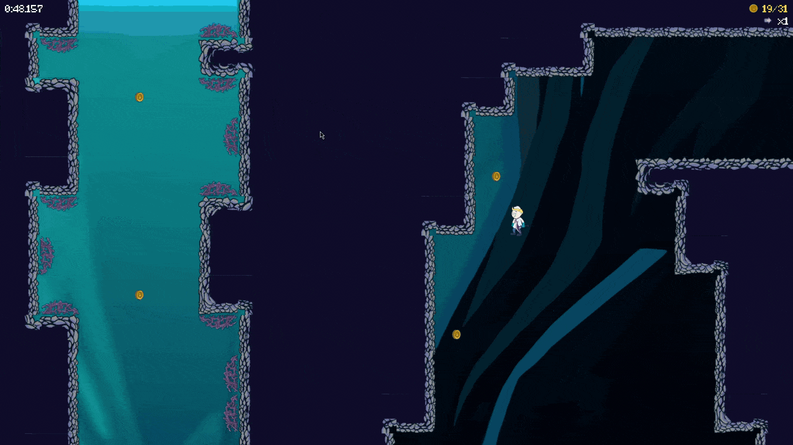
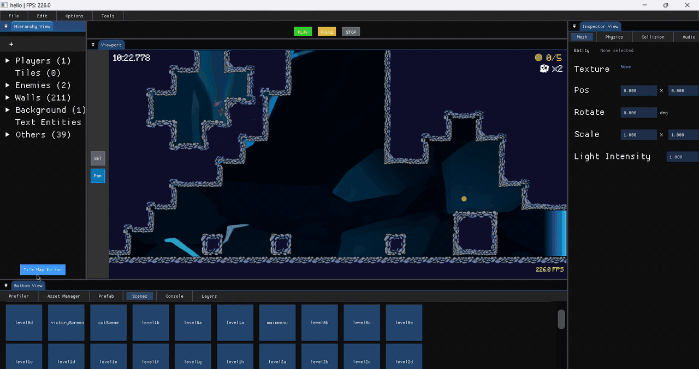
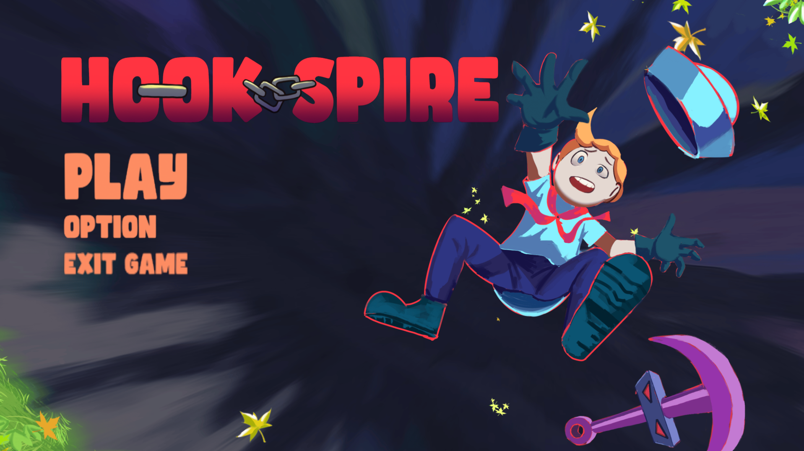

# Hookspire

A 2D puzzle platformer where you swing with a grappling hook and use physics to reach the end of each level. Every level adds a new mechanic, and some let players bend the physics system to their advantage.

<!-- [Download the Windows build](https://github.com/XavierTan-prog/Hookspire/releases/latest) · -->

| **Team** | Studio Dream, 8 people (DigiPen Institute of Technology Singapore) |
| **When** | Sep 2025 – Apr 2026 |
| **Engine** | Custom 2D engine, C++17, built with CMake |
| **My role** | Engine programmer: physics and collision, input, editor tools, UI design |

## What I built

- **Physics and collision system.** AABB and circle colliders, with a spatial grid so each object only tests its nearby neighbours instead of every other object. It held 20–30 colliding objects at 60 FPS across all 4 levels.
- The engine core's **Input System** and **Math Library**.
- **Editor tools in ImGui.** 6 editor panels, plus a **Tilemap editor** and a **Prefab editor**. Our designers used them to build all 4 levels.
- **UI design.** The main menu, level select, cutscene and ending screens, mocked up in Photopea first.

## Case study: tools for the designers

**The problem.** Before the editors existed, building a level meant hand-editing prefab files and placing every object by hand. Every change needed a programmer, and the designers couldn't iterate on their own.

**The constraint.** A team of 8 on a fixed school schedule, with 4 levels to ship on an engine we were writing ourselves at the same time.

**What I built.** A Tilemap editor for laying out levels and a Prefab editor for changing existing prefabs, both inside the engine's ImGui editor.

**What didn't work at first.** The Tilemap editor was quite limited in functionality and placing of tiles was quite confusing as the designers did not know what they were placing at the time.

**What I changed.** I added in a preview window to show what they were placing and replacing, the tiles in the editor were colour coordinated to each type of tile placed, and added in radio buttons to make it easier for designers and programmers alike to understand what they are placing

**The result.** The designers built all 4 shipped levels with these tools instead of editing files by hand.

## Case study: keeping collision fast

**The problem.** A grappling-hook game needs reliable collision. Checking every object against every other object gets slower quickly as levels fill up.

**What I chose.** AABB and circle colliders with Euclidean distance checks for circles, and a spatial grid broad phase so objects only test the cells around them.

**The result.** 20–30 colliding objects per level at a steady 60 FPS.

## Screenshots
**Tilemap Editor in Engine**

**Hookspire Mainmenu**

---
Hookspire is a student project made at DigiPen Institute of Technology Singapore. This page covers my own contributions to it.

Xavier Tan · xavier200110@hotmail.com · [LinkedIn](https://www.linkedin.com/in/xavier-tan-developer)
